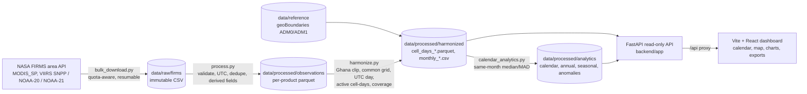

# Architecture

## Principles

- **Raw data are immutable.** Each stage reads the previous stage's files and writes new ones; the whole chain reruns with
  `python -m data_pipeline.run_all`.
- **Sensor provenance is preserved** in every table (sensor, platform, source product, per-sensor counts).
- **The API is read-only.** It serves generated artifacts and never acquires data or recomputes analytics.
- **Every table states its caveats.** Exports begin with `#` comment lines giving source, method version, area and grid.

## Components

| Component | Responsibility |
|---|---|
| `data_pipeline/bulk_download.py` | Windowed download with retry and FIRMS quota awareness |
| `data_pipeline/process.py` | Validation, timestamps, de-duplication, derived fields, covered date ranges |
| `data_pipeline/regions.py` | Vectorised Ghana clip and region assignment |
| `data_pipeline/harmonize.py` | Strategy A harmonization and monthly series with coverage |
| `data_pipeline/calendar_analytics.py` | Baselines, flags, explanations, annual and seasonal summaries |
| `backend/app/main.py`, `harmonized_routes.py` | API (`/docs` for the live schema) |
| `frontend/src` | Pages, calendar heatmap, map, charts |

## API summary

`/api/health`, `/api/metadata`, `/api/harmonization`, `/api/regions`, `/api/calendar`, `/api/calendar/anomalies`, `/api/seasonal`,
`/api/annual`, `/api/map/cells`, `/api/boundaries`, `/api/export/calendar.csv`, `/api/export/cells.csv`, plus the earlier
sensor-level endpoints (`/api/temporal/{interval}`, `/api/spatial`, `/api/baselines`, `/api/anomalies`, `/api/hotspots`) which
read outputs of the original VIIRS-only analysis and are not used by the dashboard.
